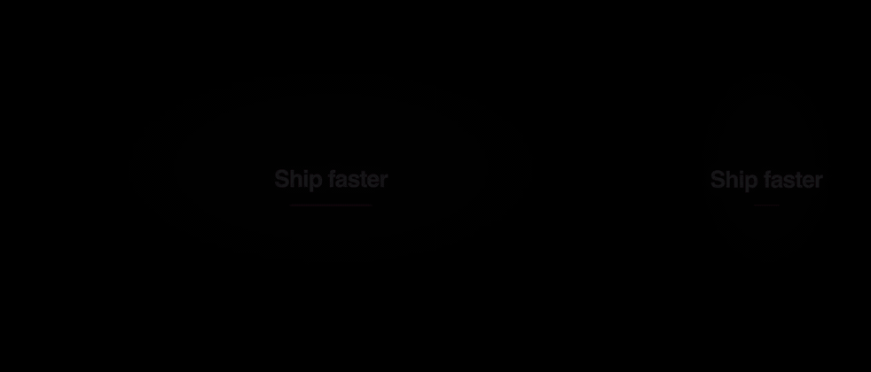
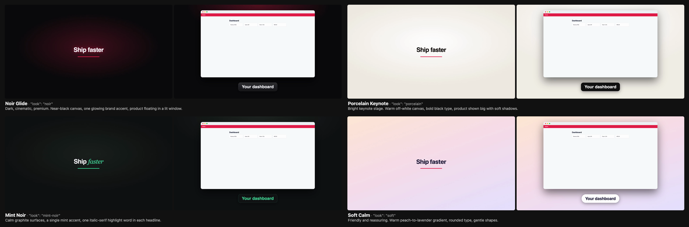

# VidGen

**From Codebase to Cinematic Product Videos.**

Installable agent skill that reads an existing project, finds its key user journeys, captures the *real* running UI, and renders promo videos — always in both **1920×1080** and **1080×1920**.



*One real screen of the test fixture app, dressed in each ready look (`/video-plan` shows you this strip before you choose):*



## Install

**Supported platform: macOS only** (tested on macOS 26, Apple silicon). Linux and Windows are not supported in v1; the installer refuses them.

```bash
node install.mjs                    # user-wide (~/.claude)
node install.mjs --project ../myapp # one project (.claude inside it)
node install.mjs --target ~/.codex  # any agent using skills/ + commands/ layout
```

Prerequisites: Node ≥ 20 with npm, and ffmpeg + ffprobe on PATH (or `VIDGEN_FFMPEG` / `VIDGEN_FFPROBE` set to full paths). Any ffmpeg build with `libx264`/`aac` works; `drawtext`/freetype is **not** needed (Chromium renders text).
- `brew install ffmpeg`

The installer checks prerequisites first, copies the skill, downloads Playwright Chromium and runs `doctor.mjs`. It exits non-zero on any failure. It is safe to re-run: VidGen's own files are replaced, VidGen commands that no longer exist are removed (tracked in `commands/.vidgen-commands.json`), and other files in `commands/` are never touched.

### Troubleshooting

`node <skill>/scripts/doctor.mjs` checks Node, ffmpeg/ffprobe, the encoders, muxers and filters VidGen uses, Playwright Chromium and local TTS. It prints the fix for each failure.

| Symptom | Fix |
|---|---|
| `voiceover failed: … no local TTS engine` | `/usr/bin/say` ships with macOS — make sure `/usr/bin` is on `PATH`, or install Kokoro (below). Or set `"voiceover": false` for music-only |
| `narration audio is stale` / `missing` | Re-run `voiceover.mjs` after changing narration, `voice` or `voiceRate` |
| `narration lasts Xs but the scene is Ys` | Raise that scene's `duration` to the value printed, or shorten the line |
| `voice "…" is not installed` | Pick a name from `say -v ?` (add voices in System Settings → Accessibility → Spoken Content) |
| `ffmpeg not found` | Install ffmpeg or set `VIDGEN_FFMPEG`/`VIDGEN_FFPROBE` |
| `encoder libx264` FAIL | Use Homebrew's ffmpeg (`brew install ffmpeg`), which includes it |
| Chromium elsewhere / managed browser | `VIDGEN_CHROMIUM_PATH=/path/to/chrome` |
| Render stuck | Each ffmpeg call is time-boxed (`VIDGEN_FFMPEG_TIMEOUT_MS`, default 600000) |
| `… refused: unsafe scene id …` / `unsafe flow name` (exit 2) | Scene ids and flow names become file names: use letters, digits, `-`, `_` (max 64), with no `/`, `..` or leading `.` |
| `… refused: refusing to write through symlink …` (exit 2) | Something under the project (e.g. `.vidgen`, `vidgen-export`, `out/`) is a symlink. VidGen won't write through symlinks inside the project: replace it with a real directory |
| Ctrl-C | Every stage exits 130 and keeps previous outputs. A force-quit (`kill -9`) cannot be caught, but staged outputs are never promoted, so old outputs survive (a `tmp/` or `captures.staging-*` folder may be left behind — safe to delete) |

## Commands

| Command | Does |
|---|---|
| `/video-analyze` | Scan routes, components, tokens, assets → cached `.vidgen/context.json` + ranked flows |
| `/video-plan [flow]` | Pitches a story and 2–3 looks with a real-screen preview, then writes the scene-by-scene storyboard |
| `/video-create [flow]` | Capture real UI (desktop + phone viewports), voiceover, render both formats |
| `/video-review [flow]` | ffprobe/blackdetect/freezedetect QA + contact sheets for visual check |
| `/video-export [flow...] [--combined]` | Final encode + QA of exported files + `vidgen-export/manifest.json`; optional combined video |
| `/video-multipleflow` | Full pipeline for every discovered flow + combined video (refused if any flow fails) |

## Layout

```
skill/
  SKILL.md                    agent entry point + rules
  commands/video-*.md         the six command procedures
  references/                 storyboard schema, looks, authentication, external context
  scripts/
    context.mjs               local-first project scan + source-hash cache
    frameworks.mjs            router adapters (Next.js, SvelteKit, React Router, Flutter, generic)
    start.mjs                 start the app's dev server and wait until it answers
    capture.mjs               Playwright capture in two real viewports, per-scene checks
    capture-cache.mjs         verified screenshot reuse
    auth.mjs                  sign-in session, login/forbidden checks, redaction, scrubbing
    voiceover.mjs             local TTS narration (macOS say or Kokoro), voice polish + leveling
    kokoro-tts.py             Kokoro neural voice helper (offline)
    setup-kokoro.sh           one-time Kokoro install (~/.vidgen/kokoro)
    narration.mjs             which narration file belongs to each scene; stale/missing detection
    looks.mjs                 look catalog (canvas, title and caption themes)
    look-preview.mjs          look pitch: one real screen rendered in each look
    render.mjs                both formats: motion, transitions, device frames, captions, audio mix
    vision.mjs                pixel fingerprints, entropy, contrast
    qa.mjs                    technical + visual QA, narration check, contact sheets
    export.mjs                final encode, per-flow + combined exports, manifest (all-or-nothing)
    external.mjs              optional DeepWiki / GitDiagram / GitIngest context, per-transfer authorization
    platform.mjs              executable lookup, path safety, signal sets
    doctor.mjs                environment check
tests/
  all.mjs                     run every suite + smoke demo
  core.test.mjs               core pipeline       auth.test.mjs        signed-in flows
  platform.test.mjs           cross-platform      cache.test.mjs       screenshot reuse
  motion.test.mjs             motion, styles, looks frameworks.test.mjs router adapters, capture checks
  external.test.mjs           external context    symlink.test.mjs     path safety
  voiceover.test.mjs          TTS engines         audio-mix.test.mjs   ducking, fades, limiter
  smoke.mjs                   end-to-end demo     frameworks-real.mjs  real Next.js/SvelteKit apps (network)
  bench-cache.mjs, bench-render.mjs                benchmarks
  fixture/                    test apps (plain, Next.js, SvelteKit) + synthetic music bed
docs/
  release-status.md           what v1 covers, platforms, known limitations
  test-report.md              latest results and measurements
.github/workflows/ci.yml      macOS CI
```

## Authenticated flows

`capture.mjs <storyboard> --login` (you sign in in a browser window) or `--cdp <url>` (reuse a browser you signed in to). Session stays in memory; storyboards may not hold credentials; scenes landing on login/forbidden pages fail; `redact` selectors hide sensitive elements. Details and limits: [skill/references/authentication.md](skill/references/authentication.md).

## Presentation

- `"look"`: `noir`, `porcelain`, `mint-noir`, `soft` dress the real screens (canvas, title cards, captions). `look-preview.mjs` renders one real screen in each look so you can choose; `/video-plan` pitches 2–3 looks with that preview first. Catalog and planned looks: [skill/references/looks.md](skill/references/looks.md).
- `"style": "device"` puts each real screenshot inside a browser window (landscape) or phone (portrait) on a brand-color canvas; `"screen"` (default) is full-bleed.
- `"subtitles": true` (or `{ "size": 36 }`, 20–120 px) adds the spoken narration as short timed phrases on a black liquid-glass pill.
- Camera moves (`zoom-in`, `zoom-out`, `pan-down`) are subpixel-smooth (ffmpeg `perspective`, bicubic interpolation).
- Story-first planning: give `/video-plan` a few lines of story (or `.vidgen/story.md`); each beat is mapped to a real screen, never an invented one.

## Audio

`storyboard.music`: `"auto"` (first file in `.vidgen/music/`, else a generated pad), `"none"`, or a path relative to the storyboard.

### Mix settings (`storyboard.audio`, all optional)

| Setting | Default | Range | Meaning |
|---|---|---|---|
| `musicVolume` | 0.7 | 0–1 | Music gain when nobody is speaking (linear) |
| `duckDb` | 15 | 0–40 | How far music drops under narration (dB) |
| `attack` | 0.4 | 0.05–2 s | Ramp down, finishing as the line starts |
| `release` | 0.8 | 0.05–3 s | Ramp back up after the line ends |
| `fadeIn` / `fadeOut` | 1 / 1.5 | 0–10 s | Music fades at the start/end (defaults shrink for short videos; explicit values that exceed the video fail) |

- Ducking follows each narration line's real start and length (not whole scenes), and ramps linearly in dB so there are no jumps.
- A peak limiter at −1 dBFS runs on every mix; the result is padded/trimmed to the exact video length.
- Music files are validated (audio stream present, fully decodable) before rendering; narration files too. Unknown settings or out-of-range values fail with exit 1. On any failure previous `out/` and `vidgen-export/` are untouched.
- Limits: ducking is schedule-based (from the known narration timing), not a sidechain compressor reacting to the voice; no loudness normalisation of user music (a very quiet track stays quiet; lower `musicVolume` for very loud ones); stereo 48 kHz only.

### Voiceover

- **Engine:** local TTS only. Default on macOS is the built-in `say` (no install, ~180 voices, but robotic; use Kokoro for promos); `VIDGEN_TTS=<engine>` forces one. No cloud TTS is integrated, so narration text never leaves the machine.
- **Natural voice (recommended): Kokoro.** `"tts": "kokoro"`, `"voice": "af_heart"` (others: `af_bella`, `am_michael`, `bf_emma`, … — 28 English voices), optional `"voiceSpeed"` 0.5–2. Kokoro-82M (Apache-2.0) runs fully offline via `kokoro-onnx`. One-time setup (~340 MB, needs `uv` or Python ≥ 3.10):
  ```bash
  sh ~/.claude/skills/vidgen/scripts/setup-kokoro.sh
  ```
  It installs to `~/.vidgen/kokoro` (or `$VIDGEN_KOKORO_DIR`) and is safe to re-run. If requested and missing, voiceover fails and prints this command.
- **Voice polish** (on by default, `"voicePolish": false` to skip): every line gets broadcast-style processing — dead air before the first word trimmed to a natural 0.12 s breath, 48 kHz resampling, rumble removed, boxiness (~250 Hz) cut, presence (~3.5 kHz) and air lifted, de-essing and gentle compression.
- **Leveling:** every synthesized line is then set to about −18 dB mean (peaks capped at −1 dBFS) so engines and lines sound equally loud.
- **Controls:** `"voiceover": true`, per-scene `narration`, optional `voice` (e.g. `"Samantha"`) and `voiceRate` (90–360 wpm). `"voiceover": false` makes a music-only video even if narration audio exists. You can also drop your own `audio/<scene>.(aiff|wav|mp3|m4a)` with `voiceover` unset.
- **Mixing:** each line starts at its scene's start. The music is pulled down smoothly while a line plays and comes back in the pauses (see *Mix settings*). AAC 48 kHz stereo; audio length equals video length in both formats.
- **Failures are loud:** no engine, unknown voice, failed or silent synthesis, a line longer than its scene, or narration that is missing or stale after a script change → exit 1 with the fix; previous `audio/`, `out/` and `vidgen-export/` stay untouched. Nothing is silently dropped.
- **Verified:** QA and export check that each narrated scene's waveform is present at its position in the final AAC track (`narrationMatch`, ≥ 0.5).
- **Limits:** one narration line per scene; no per-word timing; Kokoro needs the one-time install above.

## Supported projects

| Router adapter | Discovery | Verified against |
|---|---|---|
| Next.js | App Router and Pages Router: static pages; dynamic, catch-all and optional segments (reported, not guessed); groups stripped; API, route handlers, `_private`, `@slots` and intercepting routes excluded | synthetic trees + the real Next.js 14.2 fixture app (`tests/fixture/next-app`) |
| SvelteKit | `+page.svelte` routes, groups stripped, `[param]`/`[[optional]]`/`[...rest]` reported, `+server` excluded | synthetic trees + the real SvelteKit 2.8 / Svelte 5 fixture app (`tests/fixture/sveltekit-app`) |
| react-router | path literals in files that use the router (`:id` → `[id]`) | synthetic trees + the original React fixture |
| Flutter | go_router / MaterialApp routes | synthetic trees + a `flutter create` app |
| generic | `/` for an obvious SPA entry, otherwise none; routes come from storyboards | synthetic trees |

Nuxt, Astro, Remix, Angular and Vue are *detected* (`framework`), but their routes are **not** discovered: they use the generic fallback. Capture works for anything served over HTTP; Flutter web renders to canvas, so use `tap` with viewport fractions instead of selectors.

## Testing

Latest results and measurements: [docs/test-report.md](docs/test-report.md). Release scope and known limitations: [docs/release-status.md](docs/release-status.md).

```bash
node tests/all.mjs        # all 10 offline suites sequentially + smoke demo, with a summary
node --test tests/cache.test.mjs   # one suite
node tests/smoke.mjs      # smoke demo only
node tests/frameworks-real.mjs     # real Next.js + SvelteKit (needs npm network access)
```

## External context (optional)

Off by default; VidGen never needs it. `skill/scripts/external.mjs --plan` shows exactly what DeepWiki, GitDiagram or GitIngest would receive. A run requires `--authorize "<provider>:<target>"` matching that plan. Remote providers get only a **public** repo's name; GitIngest runs locally on a sanitized copy (it attempts a tokenizer download, which VidGen blocks on a best-effort basis). DeepWiki and GitDiagram were each live-validated once against `sveltejs/kit`; GitIngest 0.3.1 was validated on a synthetic repo. See [skill/references/external-context.md](skill/references/external-context.md).

Design: agent-agnostic (shell + Node + ffmpeg), local-first (external context only with per-transfer authorization), authentic UI only, modular scripts so new stages slot in.

## Use responsibly

- Record only apps and accounts you own or are authorized to record. VidGen captures whatever URL the storyboard names.
- Screens captured behind a login can contain real personal data. Redaction is selector-based, not automatic: review the contact sheets from `/video-review` before sharing a video.
- Narration is synthesized speech; captions, titles and claims in a video are yours to check. VidGen never invents screens, but it renders the text you give it.
- Provided as-is under the MIT License, without warranty (see below).

## License

MIT — see [LICENSE](LICENSE). Kokoro-82M (optional voice) is Apache-2.0 and downloaded separately.
